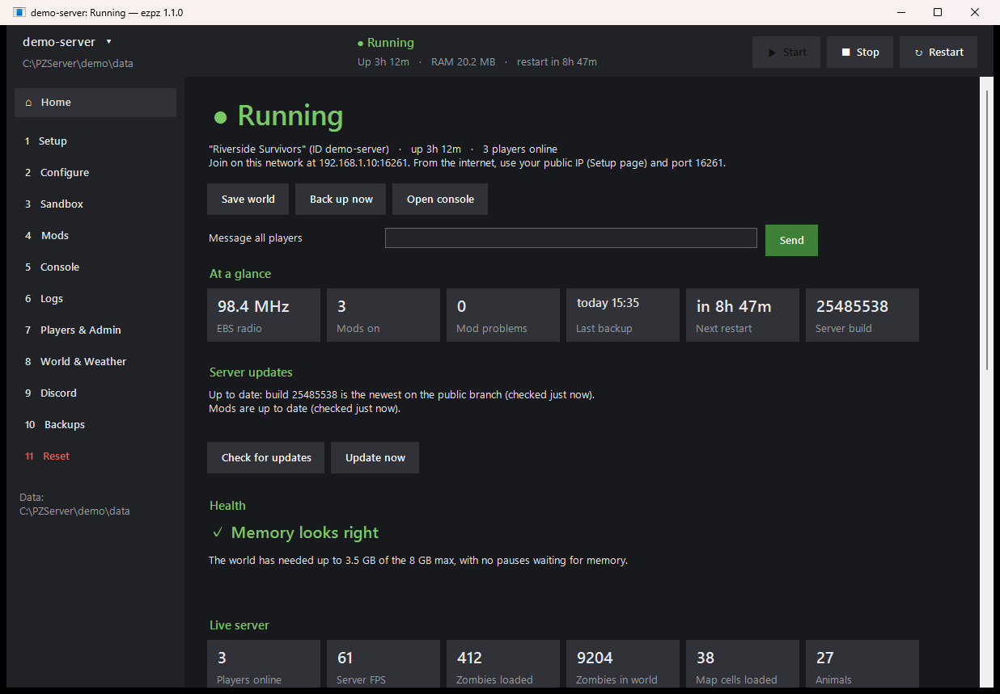
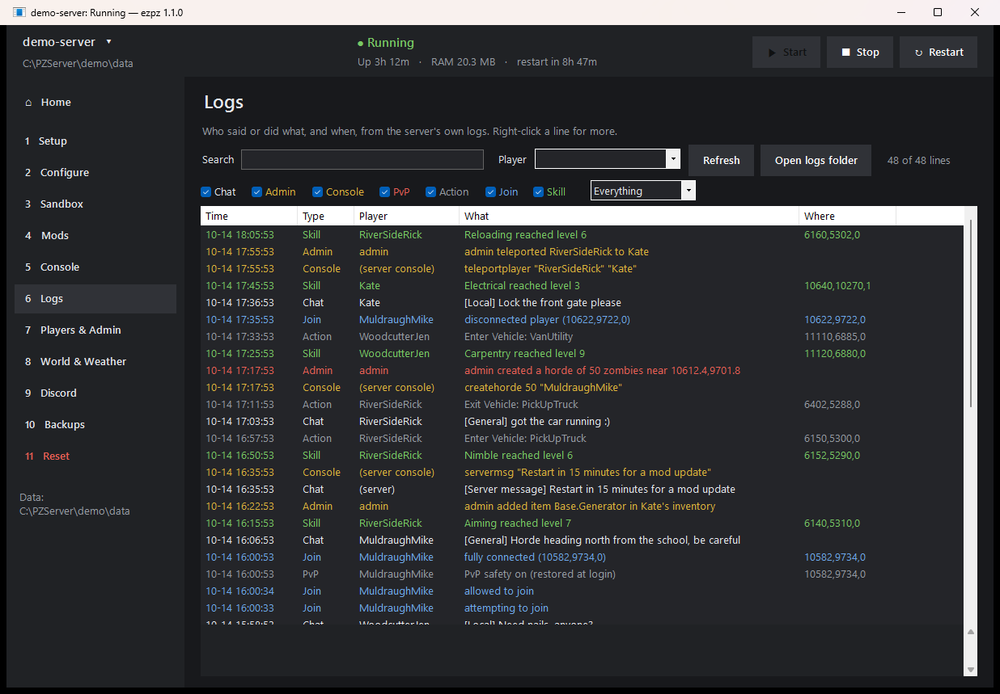
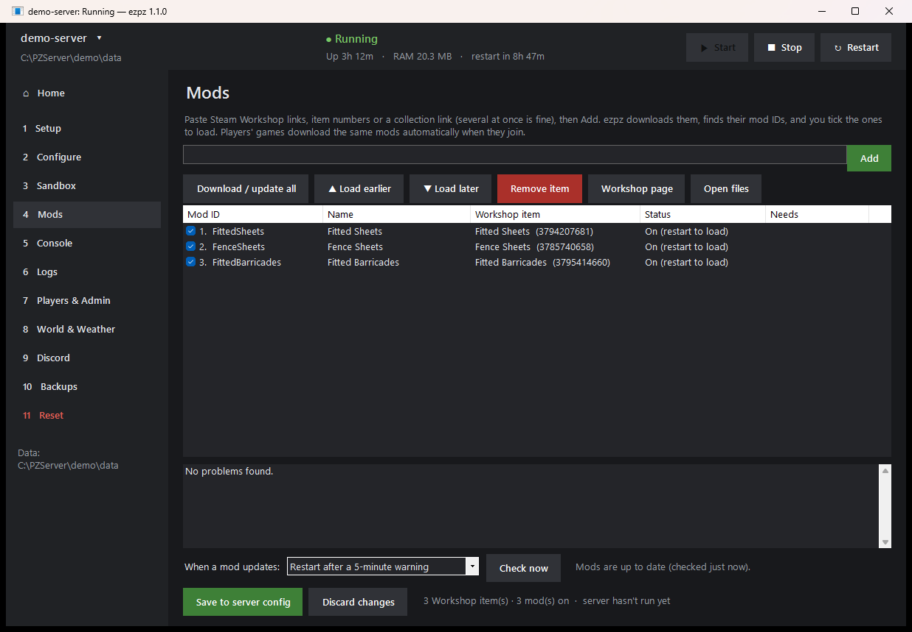
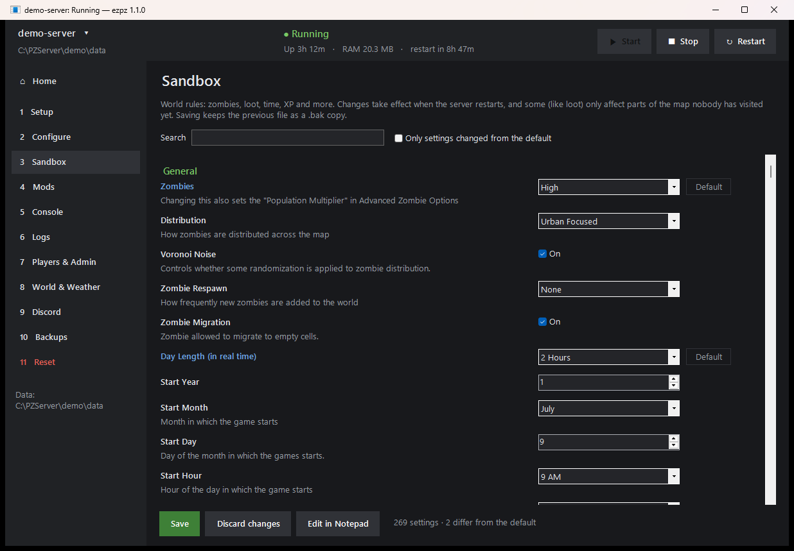
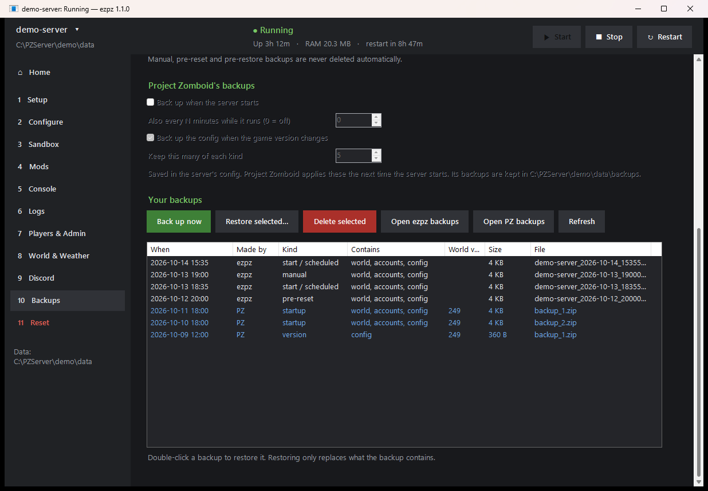
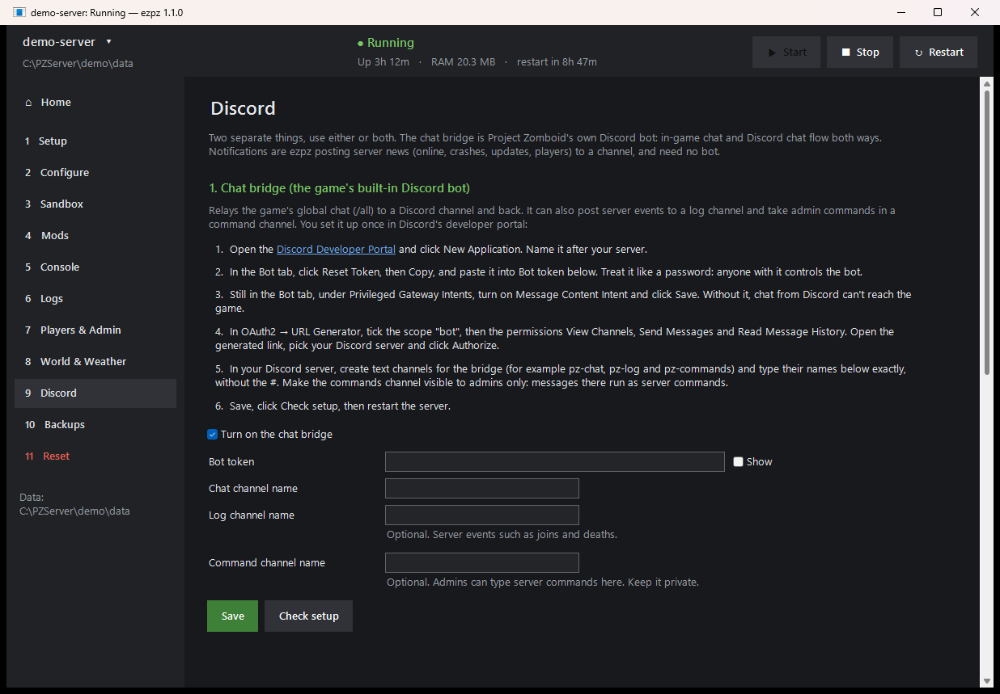

  

<h1 align="center">ezpz</h1>

  <b>Set up, run, manage and reset a Project Zomboid Build 42 dedicated server on Windows, all from one small app.</b>

  <a href="https://github.com/kruchone/ezpz/releases/latest">Download</a> ·
  <a href="https://github.com/kruchone/ezpz/wiki">Documentation</a> ·
  <a href="https://github.com/kruchone/ezpz/wiki/Getting-Started">Getting started</a>

  

ezpz is a single `.exe` with no installer and no dependencies. It installs the dedicated server for you, walks you through setup, and then gives you one place to run it: settings, mods, players, backups, Discord and more. The game itself isn't needed on the server PC.

## Features

- **[Guided setup](https://github.com/kruchone/ezpz/wiki/Setup):** install and update the server through SteamCMD, create its config, open the firewall.
- **[Home](https://github.com/kruchone/ezpz/wiki/Home-Page):** one screen with status, what needs attention, and who's on.
- **[Performance](https://github.com/kruchone/ezpz/wiki/Performance):** server updates, memory health with up to 90 days of history, and live numbers from the game.
- **[Settings](https://github.com/kruchone/ezpz/wiki/Settings) and [World rules](https://github.com/kruchone/ezpz/wiki/World-Rules):** every server setting and world rule, in plain forms.
- **[Mods](https://github.com/kruchone/ezpz/wiki/Mods):** paste Workshop links, pick what loads and in what order, and restart automatically when a mod updates.
- **[Console](https://github.com/kruchone/ezpz/wiki/Console):** the live server console, crash recovery and scheduled restarts with in-game warnings.
- **[Logs](https://github.com/kruchone/ezpz/wiki/Logs):** one searchable timeline of chat, admin actions, PvP, joins and level-ups.
- **[Players](https://github.com/kruchone/ezpz/wiki/Players):** roles, moderation, admin powers, item and vehicle pickers, character sheets, help tickets and bans.
- **[Map](https://github.com/kruchone/ezpz/wiki/Map):** the whole world from the server's own map images, with players on it.
- **[Events & weather](https://github.com/kruchone/ezpz/wiki/Events-and-Weather):** rain, storms, lightning and world events, and the emergency radio frequency.
- **[Discord](https://github.com/kruchone/ezpz/wiki/Discord):** chat bridge, notifications, a live status message, daily summaries, slash commands (including `/ladder`) and whitelist requests.
- **[Backups](https://github.com/kruchone/ezpz/wiki/Backups) and [Reset & wipes](https://github.com/kruchone/ezpz/wiki/Reset-and-Wipes):** scheduled backups with one-click restore, safe resets from "new world" to "factory reset", and scheduled wipes (a fresh world every month, with warnings).
- **[Seasons](https://github.com/kruchone/ezpz/wiki/Seasons)** (beta): a ladder of the best survivors between wipes, THE END IS NEAR with an optional finale (hordes, storms, a last helicopter out), and rewards for the winners.
- **[Several servers](https://github.com/kruchone/ezpz/wiki/Several-Servers):** keep more than one server and switch between them.
- **[EZPZ Server Tools](https://github.com/kruchone/ezpz/wiki/EZPZ-Server-Tools)** (optional companion mod, [on the Workshop](https://steamcommunity.com/sharedfiles/filedetails/?id=3823711409)): each player's health, injuries and moodles live in ezpz, and countdowns and the season ladder in game.

| | |
|---|---|
|  |  |
|  |  |
|  |  |
|  |  |
|  |  |

## Requirements

- Windows 10 or 11, 64-bit. Nothing else to install.
- 16 GB of RAM is comfortable: about 4 GB for Windows, 8 GB or more for the server.
- 15 GB or more of free disk space.

You don't need Project Zomboid, Steam, a Steam account or administrator rights on the server PC. Players need Project Zomboid on Steam, on the same version as the server. [Full requirements](https://github.com/kruchone/ezpz/wiki/Getting-Started#requirements).

## Getting started

1. Download `ezpz.exe` from the [latest release](https://github.com/kruchone/ezpz/releases/latest) and run it.
2. Follow the **Setup** page from top to bottom.
3. Adjust **Settings**, then press **Start**.
4. For players outside your home network, forward UDP 16261–16262 on your router.

The [Getting Started guide](https://github.com/kruchone/ezpz/wiki/Getting-Started) covers each step.

## More

- [Documentation (wiki)](https://github.com/kruchone/ezpz/wiki)
- [Troubleshooting and bug reports](https://github.com/kruchone/ezpz/wiki/Troubleshooting)
- [Building from source and develop builds](https://github.com/kruchone/ezpz/wiki/Building-from-Source)
- [Changelog](CHANGELOG.md)

## Disclaimer

ezpz is an unofficial community tool. It is not affiliated with or endorsed by The Indie Stone. Project Zomboid is a trademark of The Indie Stone. Use at your own risk, and keep backups.

## License

[MIT](LICENSE)
