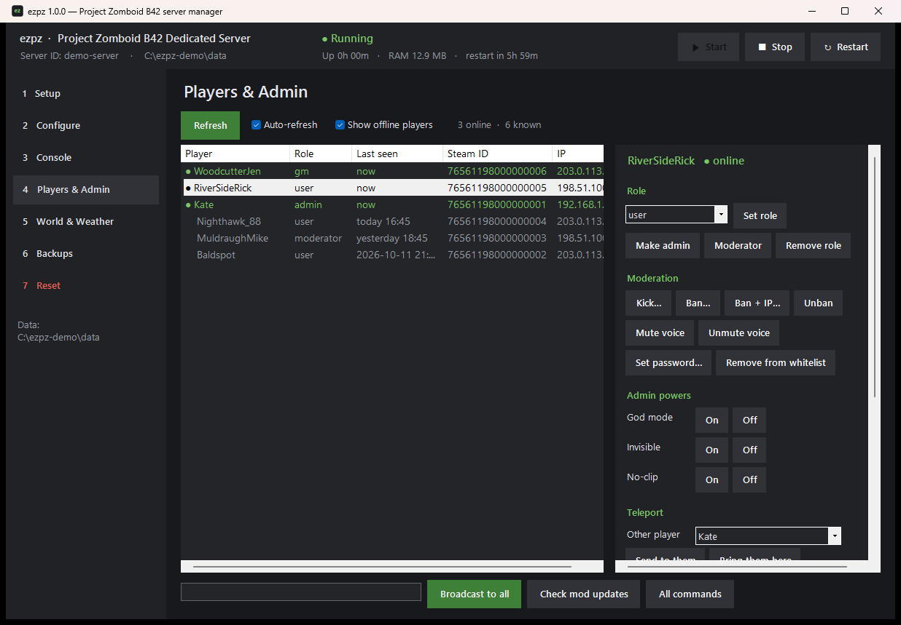
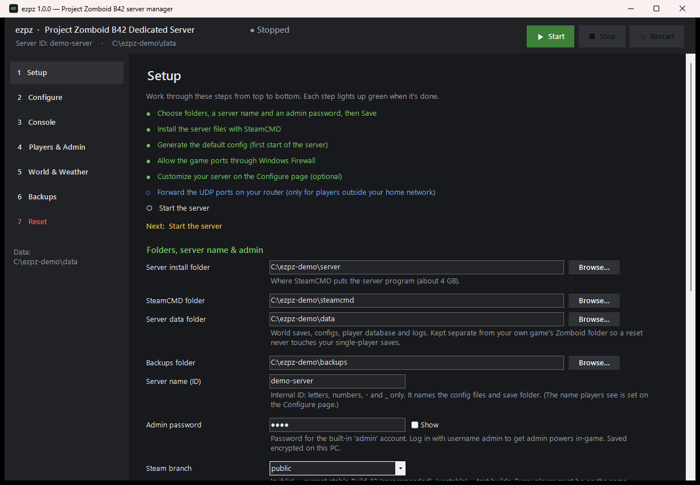
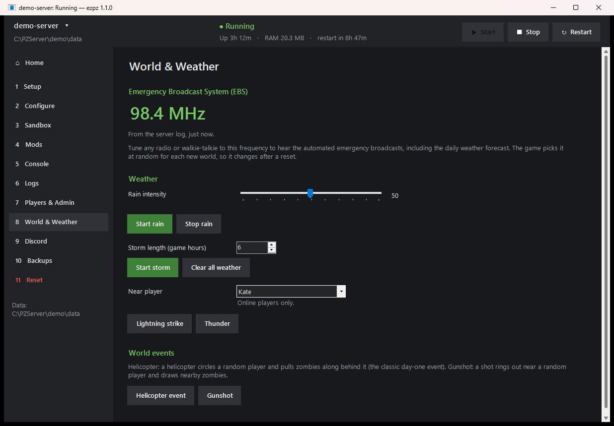
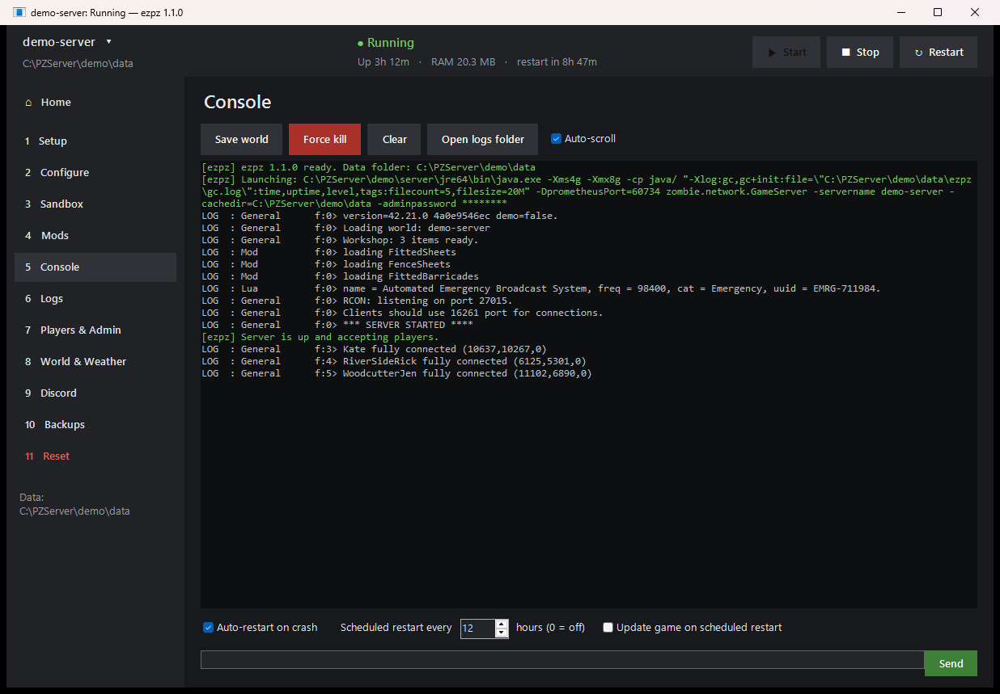
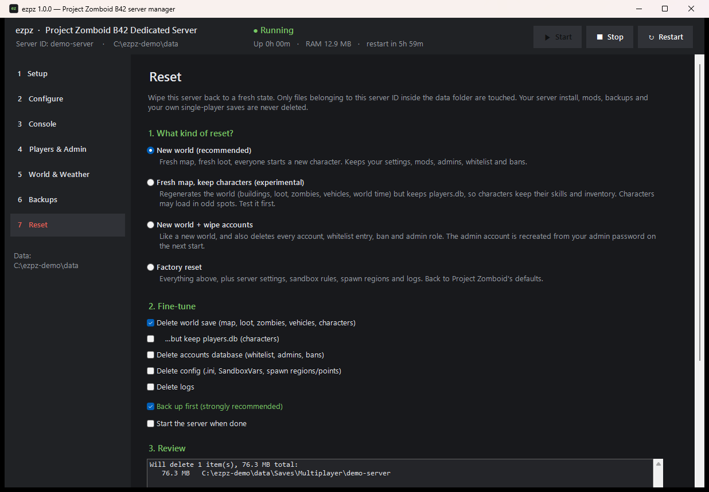

<p align="center">
  
</p>

<h1 align="center">ezpz</h1>

<p align="center">
  <b>Set up, run, manage and reset a Project Zomboid Build 42 dedicated server on Windows, all from one small app.</b>
</p>

<p align="center">
  
</p>

ezpz is a single `.exe` with no installer and no dependencies. It walks you through installing the dedicated server with SteamCMD, configuring it and opening the firewall, then gives you a console, player management, weather controls, backups and a safe **reset** button.

## Features

- **Guided setup.** A checklist turns green as you go. It covers installing or updating the server through Valve's SteamCMD (anonymous login, `public` or `unstable` branch), creating the default config, adding the Windows Firewall rule, and showing your local and public IP.
- **Configure.** Plain fields for the common settings (name, join password, max players, PvP, whitelist, ports and so on), plus a searchable grid of every `.ini` setting. You can also import `.ini` and SandboxVars files made with the in-game Host menu.
- **Sandbox.** A form for every world rule in `<server>_SandboxVars.lua` (zombies, loot, time, XP and more), with dropdowns, on/off switches and number boxes, plus search, a "changed from the default" filter and reset-to-default. It's built from the file itself, so settings added in future game versions appear automatically. It only ever changes values in place, keeps a `.bak` copy, and sends you to Notepad if the file looks unfamiliar.
- **Mods.** Paste Steam Workshop links, item numbers or a whole collection. ezpz looks the items up, downloads them with SteamCMD, reads each mod's real mod ID from its `mod.info`, and lets you tick which ones to load and in what order. It writes `WorkshopItems=`, `Mods=` and `Map=` in the Build 42 format, and warns about missing required mods, mods without a B42 version, and items with several mods to choose from. While the server runs, it watches the Workshop for mod updates and can restart after a 5-minute in-game warning, or when nobody is online, so players with the newer version can still join.
- **Console.** The live server console with command history, a clean stop that saves the world, auto-restart after a crash, and scheduled restarts that warn players in-game at 15, 5 and 1 minutes, with an optional update during the restart.
- **Home.** Opens first. It shows the server's status, uptime, players and join address, with quick actions (save, back up, message everyone). An at-a-glance row has the EBS radio frequency, mods, last backup, next restart and server build. It checks Steam for server updates and updates with one click (stop, update, start). Its health section shows how much memory the world actually needs, measured by Java rather than Windows, charted against your max, with a plain verdict and a concrete suggestion. Live tiles from PZ's built-in `stats` command show players, server FPS, zombies, loaded map cells, network traffic and today's kills and deaths. It also flags pauses waiting for memory, out-of-memory errors, Java crash reports and a max set too high for the PC.
- **Logs.** One searchable timeline of chat, admin actions, server console commands, PvP, player actions (such as vehicles), joins and leaves, and skill level-ups, from the server's own logs, including older runs. Filter by player, type and time range to answer "who said or did what, and when". Jump in from any player on the Players page.
- **Players & Admin.** Everyone who has ever joined, with online status, role, last seen, Steam ID and IP. One click sets a role (admin, moderator, gm, observer, priority, user). Also: kick, ban (optionally including the IP), mute voice, reset a password, god mode, invisibility, no-clip, teleport, give items, XP or vehicles, spawn hordes, lightning, and broadcast messages. Selecting a player shows their **character sheet**: days survived, how many characters they've had (deaths), last position, trained skills with levels in the game's own groups, and recent level-ups, from the server's `PerkLog`. While they're online it also shows how much network traffic the server has exchanged with them this session, from the metrics server.
- **World & Weather.** Shows the world's Emergency Broadcast (EBS) radio frequency. Starts rain (with intensity), storms (with length), or clears the weather. Triggers lightning, thunder, helicopter and gunshot events.
- **Several servers.** Click the server name at the top left to switch servers or add one. Each server has its own settings and data folder, and can share an install or have its own (for example, a second install on a different Steam branch). One runs at a time: switching offers to stop the running server, and ezpz won't start a server while another Project Zomboid server is running on the PC.
- **Discord.** Sets up Project Zomboid's own Discord bot, which bridges in-game chat to a channel and back and can post server events and take admin commands, with step-by-step instructions and a **Check setup** button. That button confirms the token works, the bot is in your server, it can see the channels you named, and Message Content Intent is on. Separately, ezpz can post its own notifications to any channel through a webhook: server online or stopped, crashes, restart warnings, game and mod updates, players joining and leaving, and memory problems.
- **Backups.** Choose who makes backups: ezpz, Project Zomboid's built-in system, or both for redundancy. ezpz backs up on start and optionally every few hours. PZ backs up on start, on a timer and when the game version changes. Both sets show in one list with what each contains (world, accounts, config), and any of them can be restored with a double-click. A restore only replaces what the backup contains, and ezpz always makes a safety backup first, including before every reset.
- **Reset.** Presets from "new world, keep everything else" up to "factory reset". Before anything is deleted you see exactly what will go and how big it is. A backup is made first, and you type the server ID to confirm.

| | |
|---|---|
|  |  |
|  |  |

## Requirements

**You need:**

- **Windows 10 or 11 (64-bit).** ezpz runs on .NET Framework 4.8, which is built into Windows, so there's nothing to install.
- **Memory:** about 4 GB for Windows plus whatever you give the server. 8 GB for the server suits a few friends, and big or heavily modded worlds want 10 GB or more. A PC with 16 GB of RAM is a comfortable minimum. The Home page tells you whether the server's memory is sized right.
- **Disk space:** about 7 GB for the server install, plus room for the world (it grows as players explore), mods and backups. Plan for 15 GB or more free.
- **An internet connection** to download the server and mods, and for players to connect.
- **For players outside your home network:** access to your router to forward UDP ports 16261–16262 to the server PC.

**You don't need:**

- **SteamCMD.** ezpz downloads Valve's SteamCMD for you the first time you click **Install / Update server**.
- **Project Zomboid, or Steam itself, on the server PC.** The dedicated server is a separate free download (Steam app 380870), and ezpz installs it through SteamCMD with an anonymous login, so no Steam account or game ownership is involved. You can still run the server on the same PC you play on.
- **Administrator rights**, except for the one-time Windows Firewall step, which shows the normal Windows prompt.

**Already have them?** If you already have SteamCMD or a Project Zomboid dedicated server installed, point the folders on the **Setup** page at them and ezpz uses them as they are.

**Players** need Project Zomboid on Steam, on the same version as the server. With Build 42 on the default `public` branch, that just means keeping the game updated.
## Getting started

1. Download `ezpz.exe` from the [latest release](../../releases/latest) and put it anywhere.
2. Run it. You do **not** need to run it as administrator. Only the firewall step asks for permission, through the normal Windows prompt.
   Windows SmartScreen may warn you because the app isn't code-signed. Click **More info → Run anyway**, or build it yourself from source (see below).
3. Follow the **Setup** page from top to bottom: choose folders, server name and admin password, then **Install / Update server**, **Generate default config** and **Add Windows Firewall rule**.
4. Set a join password and anything else on **Configure**, then press **Start**.

For players outside your home network, forward **UDP 16261-16262** on your router to the PC running the server. Friends join with your public IP and port 16261.


## Resetting

| Preset | Deletes | Keeps |
|---|---|---|
| **New world** (recommended) | Map, loot, zombies, vehicles, characters | Settings, mods, accounts, admins, whitelist, bans |
| **Fresh map, keep characters** *(experimental)* | Everything in the world save except `players.db` | Characters (skills, inventory), accounts, settings |
| **New world + wipe accounts** | World, plus the accounts database (whitelist, admins, bans) | Settings and mods |
| **Factory reset** | Everything for this server: world, accounts, config, logs | The server install and your backups |

Only paths inside the data folder that belong to the current server ID are ever deleted. The server install, your backups and your own single-player saves (`%USERPROFILE%\Zomboid`) are never touched.

## Where things live

| What | Default location |
|---|---|
| Server install | `C:\PZServer\server` |
| SteamCMD | `C:\PZServer\steamcmd` |
| Server data (saves, config, accounts, logs), passed to the server as `-cachedir` | `C:\PZServer\data` |
| Backups | `C:\PZServer\backups` |
| Startup problems | `%APPDATA%\ezpz\startup.log` (anything that failed to load behind the splash screen) |
| ezpz settings | One file per server in `%APPDATA%\ezpz\servers\`, and `%APPDATA%\ezpz\ezpz.ini` for the active server. Admin passwords are encrypted with Windows DPAPI. |

All of these can be changed on the Setup page.

## How it works

- **Launching.** ezpz reads the server's own `StartServer64.bat` and runs its `java.exe` line directly, swapping in your memory settings and adding `-servername`, `-cachedir` and `-adminpassword`. Because ezpz owns the server's console, it can send commands and stop the server cleanly with `quit`.
- **A server ezpz didn't start.** If ezpz finds such a server already running, it follows `server-console.txt` and sends commands over RCON. When you save on the Configure page, ezpz sets an RCON password if none exists.
- **Home: memory health.** When ezpz starts the server it adds a Java memory log (`-Xlog:gc`, written to `<data folder>\ezpz\gc.log`, rotated at 5 × 20 MB). The memory figures, chart and verdict come from that log. Pauses where the game waited for memory ("allocation stalls") are the clearest sign the max is too small. Java logs one line per waiting thread, so simultaneous lines count as one pause, and pauses in the first 3 minutes (world loading) are reported separately as normal. The live tiles come from Project Zomboid's built-in Prometheus metrics server, which ezpz turns on at launch (`-DprometheusPort=<free local port>`) and reads every 5 seconds while Home is open. Unlike console commands, this leaves nothing in the server's logs. For a server started without it, ezpz falls back to the `stats` console command once a minute.
- **Mods.** Workshop items are downloaded with SteamCMD (anonymous login) into the server's own Workshop folder, the same place the server looks for them. Titles and collections come from Steam's public Web API. `Mods=` is written with a leading backslash on each ID (`Mods=\ModA;\ModB`), the format Build 42 servers accept. Whether each mod actually loaded is read from the server log.
- **Discord.** The chat bridge is the game's built-in bot (Javacord), configured through `DiscordEnable`, `DiscordToken`, `DiscordChatChannel`, `DiscordLogChannel` and `DiscordCommandChannel` in the server `.ini`. Channels are matched by name, and the bot needs the Message Content intent. Notifications are plain webhook posts from ezpz. The webhook URL is stored encrypted, like the admin password.
- **Mod updates.** The server records when each installed mod was last updated (`steamapps\workshop\appworkshop_108600.acf`), and ezpz compares that with the Workshop using the same keyless Steam Web API as the Mods page. It checks every 10 minutes while the server runs.
- **Server updates.** ezpz compares the installed build (from the server's Steam manifest) with the newest build on your branch, using `steamcmd +app_info_print 380870`.
- **Player list.** Built from the server's `*_connections.txt` logs, which record role, Steam ID and IP. Who is online is followed live from the same log (`fully-connected` and `disconnect` events), so ezpz doesn't poll with console commands. A quiet `players` check every 5 minutes corrects anything the log missed.
- **Firewall.** The Setup step adds two rules: allow the game's UDP ports, and block inbound TCP to the server's `java.exe` from other machines. Players only use UDP, and the TCP listeners (the metrics server and RCON) are meant for this PC. Windows otherwise allows `java.exe` on first launch.
- **EBS frequency.** Read from the server's startup log, where the game prints the channel it picked for the world.

## Building from source

No SDK needed. Windows includes the C# compiler.

```bat
build.bat
```

This produces `ezpz.exe`. To rebuild while a copy is running, pass another name: `build.bat ezpz-new.exe`.

The source is plain C# 5 / WinForms in `src\`. For development, `ezpz.exe --page N` opens on page N, and setting the `EZPZ_HOME` environment variable makes ezpz use a different settings folder, which is handy for testing against a throwaway server.

## Develop builds and branches

- **Stable:** the [latest release](../../releases/latest). Use this for your server.
- **Develop:** the [Develop build](../../releases/tag/develop-build) pre-release, rebuilt on every change to the `develop` branch. It has the newest features and may have bugs. Its version (shown in the title bar) looks like `1.1.0-dev.12+a8414f3`: the upcoming version, the build number and the commit. Keep backups.

Branches: `main` holds released code, and releases are tagged `vX.Y.Z`. `develop` collects work for the next release. New features are built on `feature/<name>` branches off `develop` and merged back into `develop` through a pull request. Every push and pull request is built automatically.
## Disclaimer

ezpz is an unofficial community tool. It is not affiliated with or endorsed by The Indie Stone. Project Zomboid is a trademark of The Indie Stone. Use at your own risk, and keep backups.

## License

[MIT](LICENSE)
